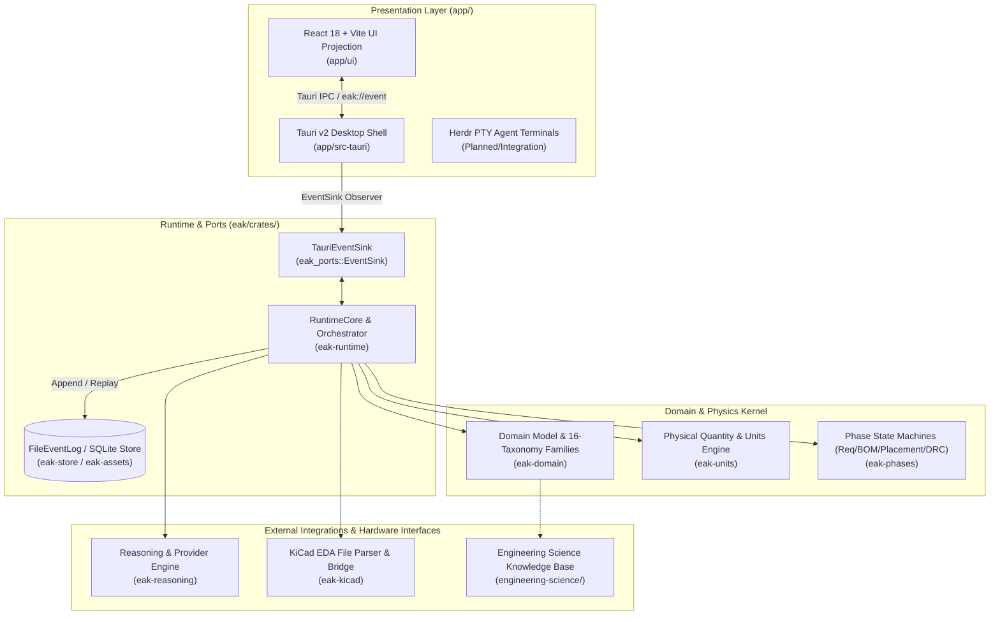

# Electronics Agent Kit (EAK)

**Developed by TUSK INNOVATIONS GLOBAL PRIVATE LIMITED**  
*Intent In. Manufactured Board Out.*

[](https://github.com/NijoP/electronics-agent-kit-proto)
[](eak/Cargo.toml)
[](app/src-tauri/tauri.conf.json)
[](app/ui/package.json)

---

## Leadership & Corporate Ownership

* **Company:** TUSK INNOVATIONS GLOBAL PRIVATE LIMITED
* **Founder & CEO:** Nijo Ponnachan
* **CTO:** Anjai Itty Jacob
* **GitHub Profile:** [https://github.com/NijoP](https://github.com/NijoP)
* **Repository:** [https://github.com/NijoP/electronics-agent-kit-proto](https://github.com/NijoP/electronics-agent-kit-proto)

TUSK INNOVATIONS GLOBAL PRIVATE LIMITED is a deep-technology hardware engineering software venture building next-generation AI-assisted systems for electronics design automation (EDA). Electronics Agent Kit (EAK) is the company's core platform prototype designed to bring deterministic engineering rigor, formal requirements tracing, and agentic workflows to electronics product development.

---

## About Electronics Agent Kit (EAK)

Electronics product design is traditionally broken across siloed, disconnected tools:
1. **Component Intelligence & Datasheets:** Engineers spend hundreds of hours manually reviewing PDF datasheets, deciphering pinouts, cross-checking operating limits, and verifying footprint metadata.
2. **Requirements Traceability:** High-level product specifications (power budgets, operational limits, physical dimensions) are rarely systematically linked to the schematic nets or the components chosen.
3. **EDA Fragmentation & Rule Verification:** Electrical Rule Checks (ERC) and Design Rule Checks (DRC) often execute as post-layout validation steps rather than continuous, automated constraints.
4. **General AI Chatbot Limits:** Generic language models lack domain-specific physics knowledge, unit awareness, electrical topology constraints, and deterministic verification capabilities required for hardware manufacturing.

**Electronics Agent Kit (EAK)** addresses this fragmentation by establishing an end-to-end, domain-first engineering environment. EAK combines an event-sourced Rust engineering kernel with an extensible agent runtime, structured physical quantities, datasheet parsing, and native EDA integration (KiCad)—grounding AI reasoning in verifiable physical laws and determinism.

---

## Working Prototype & Current Implementation

The repository contains an active, modular working prototype structured across a clean-architecture Rust core, a standalone Tauri desktop application shell, a React/TypeScript projection interface, and comprehensive engineering architecture specifications.

### Capability Maturity Matrix

| Capability | Current Status | Description & Evidence in Codebase |
|---|---|---|
| **Clean Architecture Rust Workspace** | **IMPLEMENTED** | Multi-crate workspace enforcing unidirectional dependency flow with domain models, ports, and runtime isolation ([`eak/Cargo.toml`](eak/Cargo.toml)). |
| **Domain Data Model & Taxonomy** | **IMPLEMENTED** | Strongly typed models for requirements, components, pins, nets, footprints, violations, and 16 component taxonomy families ([`eak/crates/eak-domain/`](eak/crates/eak-domain/)). |
| **Event-Sourced Runtime Kernel** | **IMPLEMENTED** | Immutable append-only event log (`FileEventLog`), state reconstruction via replay, and logical/system clocking ([`eak/crates/eak-runtime/`](eak/crates/eak-runtime/), [`eak/crates/eak-store/`](eak/crates/eak-store/)). |
| **Unit & Physical Quantity Engine** | **IMPLEMENTED** | Strict unit definitions, SI prefixes, and dimensional analysis for electrical and physical calculations ([`eak/crates/eak-units/`](eak/crates/eak-units/)). |
| **CLI Pipeline & Diagnostics** | **IMPLEMENTED** | Commands for `run`, `replay`, `trace`, provider configuration, and asset analysis ([`eak/crates/eak-cli/`](eak/crates/eak-cli/)). |
| **Desktop Application Shell (Tauri v2)** | **IMPLEMENTED** | Native desktop wrapper using Tauri v2 bridging kernel events to the webview via `EventSink` ([`app/src-tauri/`](app/src-tauri/)). |
| **Reactive Web UI Projection** | **IMPLEMENTED** | React 18 / TypeScript / Vite UI rendering design trees, event streams, inspector, and findings from committed event folds ([`app/ui/`](app/ui/)). |
| **Datasheet Parsing & Fact Extraction** | **PARTIALLY IMPLEMENTED** | PDF parsing, tabular fact extraction, parameter storage, and cross-checking in SQLite ([`eak/crates/eak-assets/`](eak/crates/eak-assets/)). |
| **Model Provider Abstraction** | **PARTIALLY IMPLEMENTED** | Provider endpoints, credential management, model listing, and cassette replay engines ([`eak/crates/eak-reasoning/`](eak/crates/eak-reasoning/)). |
| **KiCad EDA Integration** | **PARTIALLY IMPLEMENTED** | Bidirectional parsing foundations for KiCad 8 schematic/PCB formats and basic symbol import ([`eak/crates/eak-kicad/`](eak/crates/eak-kicad/)). |
| **Phase State Machines (ERC/DRC/DFM)** | **PARTIALLY IMPLEMENTED** | Pipeline state machine skeletons and verification gates for planning, placement, routing, and DFM ([`eak/crates/eak-phases/`](eak/crates/eak-phases/)). |
| **Interactive Terminal Integration (Herdr)** | **EXPERIMENTAL / PLANNED** | Persistent PTY agent workspace architecture documented and prepared for integration ([`docs/8-terminal-herdr-architecture/`](docs/8-terminal-herdr-architecture/)). |
| **Autonomous PCB Placement & Routing** | **PLANNED** | Constraint-guided placement engines and topological routing algorithms specified in engineering roadmaps ([`docs/16-master-implementation-roadmap/`](docs/16-master-implementation-roadmap/)). |
| **Full Manufacturing Export Parity** | **PLANNED** | Native generation of Gerber X2, IPC-2581, and pick-and-place packages directly through verified kernel states. |

---

## System Architecture

EAK is architected around an event-sourced core where state is never mutated in-place; all engineering actions are emitted as domain events, validated by rules engines, and folded into an in-memory `EngineeringState`.



---

## Technology Stack

* **Core Kernel:** Rust (2021 Edition, Rust 1.74+)
  * **Serialization & Storage:** `serde`, `serde_json`, `rusqlite` (bundled SQLite 3), `uuid`, `chrono`
  * **CLI Framework:** `clap` (v4 with derive macros)
  * **Concurrency & Safety:** `parking_lot`, `thiserror`, `once_cell`
* **Desktop Application Shell:** Tauri v2 (`@tauri-apps/api`, `tauri-build`)
* **Frontend Application:**
  * **Core:** React 18.3, TypeScript 5.6, Vite 5.4
  * **State Management:** Zustand 4.5
  * **Icons & Styling:** Lucide React, Custom CSS Variables & Graphite CMF Design System
* **Domain & Validation Tooling:** Python 3.11 validation scripts, JSON Schema specifications
* **EDA Targets:** KiCad 8.x schematic (`.kicad_sch`) and layout (`.kicad_pcb`) formats

---

## Repository Structure

```text
electronics-agent-kit-proto/
├── .github/workflows/          # GitHub Actions CI definitions
├── app/                        # Desktop IDE shell & frontend
│   ├── src-tauri/              # Tauri v2 Rust application backend & EventSink bridge
│   │   ├── src/main.rs         # Native entry point and event stream dispatcher
│   │   └── tauri.conf.json     # Tauri app configuration & bundle definitions
│   └── ui/                     # React + TypeScript user interface
│       ├── public/fixtures/    # Replayable golden event streams (hero.jsonl, review.jsonl)
│       └── src/                # UI components, event folds, and EDA projection stores
├── docs/                       # Canonical architecture and specification suite
│   ├── 1-product-vision/       # Core philosophy and non-negotiable principles
│   ├── 3-system-architecture/  # High-level component decomposition
│   ├── 4-engineering-model/    # Domain entity specifications
│   ├── 16-master-implementation-roadmap/ # Detailed milestone gates
│   └── development/            # Visual HTML roadmap reports
├── eak/                        # Rust Core Workspace (Clean Architecture)
│   ├── Cargo.toml              # Workspace root configuration
│   └── crates/
│       ├── eak-assets/         # Datasheet parsing, fact extraction & SQLite storage
│       ├── eak-cli/            # CLI driver, subcommand dispatch, and pipeline runner
│       ├── eak-domain/         # Canonical entities, taxonomy, and relations
│       ├── eak-kicad/          # KiCad file parsing and interoperability layer
│       ├── eak-phases/         # Deterministic engineering phase state machines
│       ├── eak-ports/          # Trait boundaries (ReasoningEngine, EventSink)
│       ├── eak-reasoning/      # Provider adapters & cassette replay fixtures
│       ├── eak-runtime/        # Kernel runtime, orchestrator, and event store
│       └── eak-units/          # Strongly typed electrical & physical units
├── engineering-science/        # Domain rules, physics formulas & compliance specs
│   ├── compliance/             # Regulatory guidelines (CE, FCC, RoHS)
│   ├── electrical/             # Circuit equations and electrical constraints
│   └── pcb/                    # High-speed design rules, clearances, and stackups
└── scripts/                    # Taxonomy and verification scripts
```

---

## Installation & Development Setup

### Prerequisites

* **Rust Toolchain:** Stable Rust 1.74 or later (`cargo`, `rustc`)
* **Node.js Environment:** Node.js 18+ and `npm`
* **Desktop Platform Dependencies:** See [Tauri v2 Prerequisites](https://v2.tauri.app/start/prerequisites/) for your OS (e.g., C++ build tools on Windows, `webkit2gtk` on Linux)

### 1. Clone the Repository

```bash
git clone https://github.com/NijoP/electronics-agent-kit-proto.git
cd electronics-agent-kit-proto
```

### 2. Inspect and Run the Core CLI

The CLI provides entry points for running pipelines, replaying logs, and testing model provider connectivity:

```bash
# Navigate to the Rust workspace
cd eak

# Run the pipeline with the deterministic hero cassette
cargo run -p eak-cli -- run \
  --intent "USB-C powered I2C temperature sensor, < 1 W" \
  --reasoning fixture \
  --cassette crates/eak-cli/fixtures/hero_cassette.json \
  --deterministic

# Replay an existing event log to view reconstructed engineering state
cargo run -p eak-cli -- replay --log eak-events.jsonl --show-state
```

### 3. Run the Frontend Workspace

The frontend can run standalone in a browser by replaying recorded kernel cassettes without needing Tauri system dependencies:

```bash
cd app/ui
npm install
npm run dev
```

Run frontend unit tests and type checks:

```bash
npm test
npm run build
```

### 4. Run the Full Desktop Application

To launch the native desktop shell connecting the Rust backend with the React frontend:

```bash
cd app
# Using Tauri CLI
cargo tauri dev
```

---

## Development Roadmap

The project follows a structured, milestone-driven roadmap defined in [`docs/16-master-implementation-roadmap/`](docs/16-master-implementation-roadmap/):

* **Stage 1: Foundation Kernel & Desktop Spine (Current Baseline)**
  * [x] Event-sourced data model and 16-family component taxonomy
  * [x] Dimensional unit engine and physical quantity validation
  * [x] Tauri v2 desktop shell with live `EventSink` forwarding
  * [x] React 18 UI projection store replaying verified kernel event streams
* **Stage 2: Datasheet Intelligence & Component Sourcing (Active)**
  * [x] SQLite-backed asset metadata and parsing models
  * [/] High-precision parameter extraction for active/passive ICs
  * [ ] Live supplier API integration (LCSC, Octopart)
* **Stage 3: Native EDA Bidirectional Sync (In Progress)**
  * [/] KiCad 8 S-expression schematic & PCB layout parser
  * [ ] Live netlist synchronization and cross-probing
  * [ ] EasyEDA Pro / KiCad round-trip export
* **Stage 4: Autonomous Placement & Routing (Planned)**
  * [ ] Deterministic component placement rules engine (keepouts, thermal, RF)
  * [ ] Topological routing assistant with continuous DRC
* **Stage 5: Production Release & Certification (Planned)**
  * [ ] End-to-end automated manufacturing bundle verification (Gerber, BOM, CPL)

---

## Engineering Design Philosophy

1. **Deterministic Foundations Over Heuristics:** AI suggestions must always be validated against immutable electrical equations, physical limits, and formal design rules.
2. **Event-Sourced Traceability:** Every decision, requirement derivation, and net change is an append-only event with cryptographic provenance.
3. **Open EDA Interoperability:** EAK is built to complement and interface directly with established EDA ecosystems (KiCad, EasyEDA) rather than enforcing closed, proprietary formats.
4. **Human-in-the-Loop Oversight:** High-risk automated modifications require explicit engineer review, gated approval, and reversible transactions.

---

## License & Intellectual Property

* **Copyright:** © 2026 TUSK INNOVATIONS GLOBAL PRIVATE LIMITED. All rights reserved.
* **Open Source Licensing:** The core software crates and desktop shell are configured under dual **MIT OR Apache-2.0** licensing terms (refer to [`eak/Cargo.toml`](eak/Cargo.toml)).

---

## Corporate Contact & Inquiries

**TUSK INNOVATIONS GLOBAL PRIVATE LIMITED**  
*Deep-Tech Hardware Engineering Automation Systems*

* **Founder & CEO:** Nijo Ponnachan ([GitHub](https://github.com/NijoP))
* **CTO:** Anjai Itty Jacob
* **Project Repository:** [https://github.com/NijoP/electronics-agent-kit-proto](https://github.com/NijoP/electronics-agent-kit-proto)
* **General & Investor Inquiries:** Contact via official company channels and GitHub organization portal.
